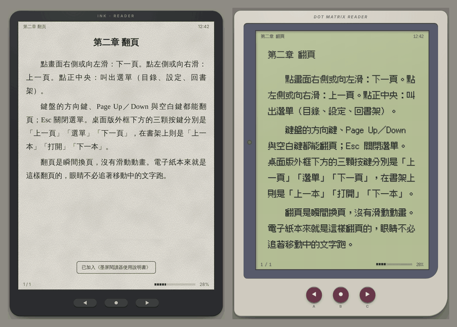
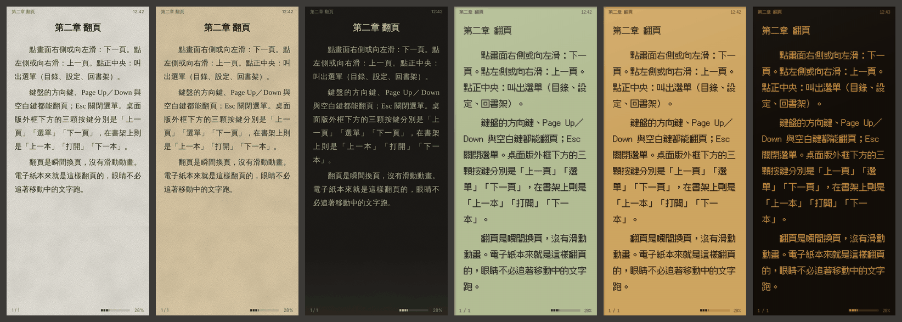
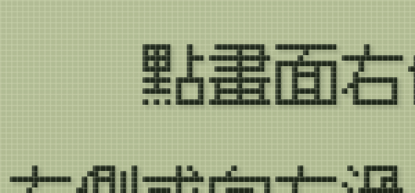

# 墨屏閱讀器

在瀏覽器裡閱讀自己的 TXT／EPUB。介面模擬**電子紙**與**反射式點陣液晶**（電子雞、掌上遊戲機那種）的質感，並以護眼為導向設計配色、排版與翻頁方式。





## 特色

- **極簡、零依賴**：純 HTML／CSS／JavaScript，沒有建置步驟與第三方函式庫。EPUB 用瀏覽器內建的 `DecompressionStream` 解壓。
- **書只存在本機**：檔案與閱讀進度存在瀏覽器的 IndexedDB，不會上傳。
- **TXT**：自動判斷 UTF-8／UTF-16／GB18030（GBK）／Big5 編碼；偵測「第一章」「第十回」「Chapter 3」等標題做成目錄；硬換行的文字會自動接回段落。
- **EPUB**：讀取 EPUB 3 nav 或 EPUB 2 NCX 目錄，支援書內連結、圖片與 ruby 注音。章節內容以白名單重建，不執行書中的腳本，也不套用書本自帶的 CSS。
- **兩種材質 × 三種光線**：電子紙（霧面紙色、紙張顆粒、前光落差）與液晶（點陣格線、反射板陰影、玻璃反光），各有日光、暖光、夜間，也可以依時間自動切換。
- **像素字對齊點陣**：液晶模式附 [Fusion Pixel](https://github.com/TakWolf/fusion-pixel-font) 12px 字型，字級、行高、欄寬都會對齊點距，每個字型像素剛好落在一個液晶點上。

  

- **分頁閱讀**：瞬間翻頁，沒有捲動或滑動動畫。改字級、換字型或旋轉螢幕後，會停在同一句話。
- **護眼設計**：文字對比 7.5–12:1（不用純黑白）、白天正像、夜間低藍光與軟體調暗、可調字級／行距／行寬、20-20-20 休息提醒。依據與取捨寫在 [docs/eye-care-research.md](docs/eye-care-research.md)。

## 使用

不需要安裝。下載專案後擇一：

- 直接用瀏覽器打開 `index.html`；
- 或在專案資料夾啟動任一靜態伺服器，例如 `python3 -m http.server`，再開 <http://localhost:8000>；
- 或部署到 GitHub Pages，用手機開啟（見下一節）。

## 部署到 GitHub Pages（用手機開）

專案不需要建置，GitHub Pages 直接發佈檔案即可。根目錄的 `.nojekyll` 會關掉 Jekyll，檔案原樣發佈。

1. 確認 repo 是公開的。GitHub Free 只能從公開 repo 發佈 Pages；私人 repo 需要 GitHub Pro 以上的方案。網站本身一律公開，但**書不會**：書只存在讀者自己的瀏覽器裡，不在 repo 裡。
2. 打開 repo 的 **Settings → Pages**。
3. 在 **Build and deployment → Source** 選 **Deploy from a branch**。
4. Branch 選放這份程式的分支，資料夾選 **/ (root)**，按 **Save**。
5. 等幾分鐘（最多約 10 分鐘），重新整理頁面，會出現「Your site is live at …」。網址的格式是 `https://<帳號>.github.io/<repo>/`。
6. 之後每次推送到這個分支，網站會在幾分鐘內自動更新。手機上會先用離線快取開啟，在背景下載新版，下次開啟時就是新版。

### 加到手機主畫面

- **iPhone／iPad（Safari）**：分享 → 加入主畫面。之後從主畫面圖示開啟，會全螢幕顯示，也能離線使用。
  Safari 分頁和主畫面 App 的書架是**分開**的，而且 Safari 分頁的資料太久沒開可能被系統清除，所以請在主畫面 App 裡匯入書。
- **Android（Chrome）**：選單 → 安裝應用程式（或「加到主畫面」）。

手機上的字型：iPhone 沒有內建可用的中文明體與楷體，選了也會以蘋方顯示；Android 有明體（思源宋體），沒有楷體。像素字型隨閱讀器附帶，各平台都一樣。

書架是空的時候可以按「載入使用說明書」，內建的說明書本身就是一本示範用的 TXT。

### 操作

| 動作 | 方式 |
|---|---|
| 下一頁 | 點畫面右側、向左滑、→／↓／PageDown／空白鍵、滾輪向下、機身 ▶ 鍵 |
| 上一頁 | 點畫面左側、向右滑、←／↑／PageUp／Shift+空白鍵、滾輪向上、機身 ◀ 鍵 |
| 選單（目錄、設定、回書架） | 點畫面中央、Enter、機身 ● 鍵 |
| 目錄 | 選單 → 目錄，或按 `T` |
| 關閉面板 | Esc |
| 匯入 | 書架「＋ 匯入」，或把檔案拖進畫面 |
| 返回（手機） | 返回鍵／返回手勢會依序關掉休息提醒、目錄或設定，再回到書架 |

在書架上，機身的 ◀ ▶ 鍵移動游標，● 鍵打開書。

## 瀏覽器支援

需要支援 `DecompressionStream('deflate-raw')` 的瀏覽器：Chrome／Edge 80+、Safari 16.4+、Firefox 113+。

在無痕視窗中，關閉視窗後書架會被清空。清除網站資料也會刪掉書架，重要的檔案請自己保留一份。

## 專案結構

```
index.html              頁面骨架、圖片濾鏡（16 階／4 階灰）
manifest.webmanifest    加到主畫面用的 App 資訊
sw.js                   離線快取（service worker）
icons/                  主畫面圖示
css/reader.css          六組色票、材質疊層、裝置外殼、排版
js/db.js                IndexedDB（書檔、進度）與 localStorage（偏好設定）
js/zip.js               最小 ZIP 讀取器
js/epub.js              EPUB 解析與白名單重建
js/txt.js               TXT 編碼判斷、段落與章節切分
js/paginator.js         CSS 多欄分頁、字元級閱讀位置
js/sprites.js           點陣小圖（眼眼）
js/guide.js             內建使用說明書
js/app.js               書架、閱讀、設定、休息提醒
fonts/                  Fusion Pixel 12px Proportional TC（SIL OFL 1.1）
docs/eye-care-research.md  護眼設計研究筆記與參考文獻
```

## 授權

`fonts/fusion-pixel-12px-proportional-tc.woff2` 為 TakWolf 的 Fusion Pixel Font，以 SIL Open Font License 1.1 授權，全文見 [fonts/OFL.txt](fonts/OFL.txt)。
